<p align="center">
  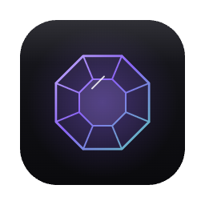
</p>

<h1 align="center">Onyx</h1>

<p align="center">
  <b>An experimental code editor for macOS that runs coding models on your own machine and treats every one of them as untrusted: an edit is a proposal until you accept it, and a command runs only when you approve it.</b>
</p>

<p align="center">
  <a href="https://github.com/sheehanlloyd/Onyx/actions/workflows/onyx-ci.yml"></a>
  <a href="https://github.com/sheehanlloyd/Onyx/actions/workflows/onyx-packaged.yml"></a>
  <a href="https://github.com/sheehanlloyd/Onyx/actions/workflows/onyx-nightly.yml"></a>
</p>

<p align="center">
  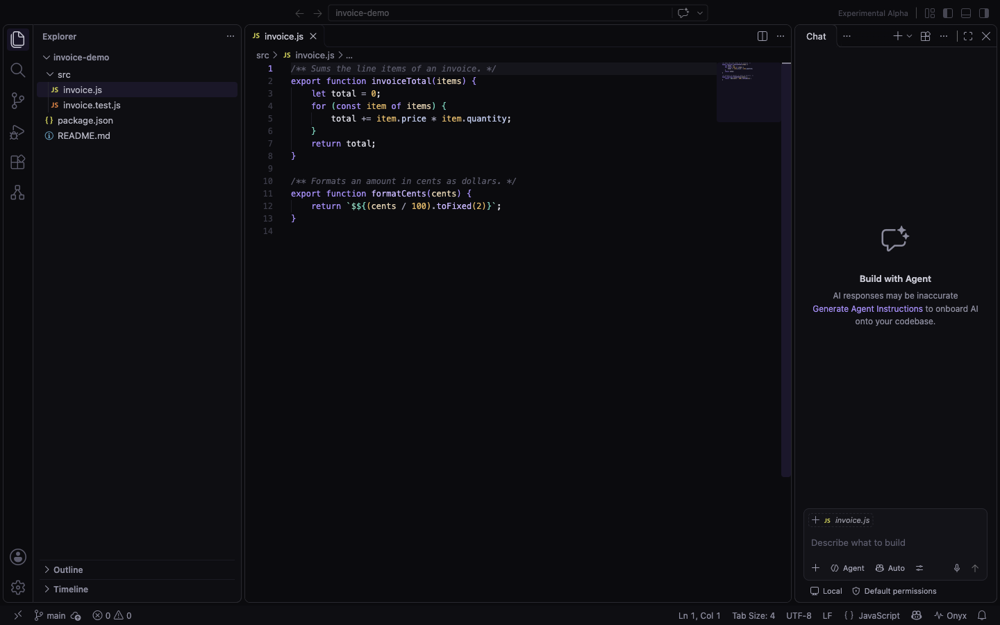
</p>

<p align="center">
  <a href="#download"><b>Download</b></a> ·
  <a href="./docs/SUPPORT.md">What is supported</a> ·
  <a href="./docs/SUPPORT.md#tool-capability-contract-b3-dec-03">What the agent can do</a> ·
  <a href="#research">Research</a> ·
  <a href="./docs/research/REPORT.md">Report</a> ·
  <a href="./ROADMAP.md">Status</a>
</p>

- **Nothing changes without you.** A model's edit is staged and placed only where its quoted text matches your file exactly, once; otherwise it is refused and your file is untouched. Every shell command asks, every time, with Run Once or Deny.
- **It measures instead of assuming.** A model's advertised abilities configure nothing. A one-minute datasheet measured on your Mac does, and `Onyx: Measure Models for This Repository` scores your models on tasks from your own git history, on your machine. What the datasheet chooses is not yet shown to be the best choice: for both pinned models it selects the constrained envelope, under which neither got an edit on record in H-2's 160 runs each, while the repaired-text protocol had an edit on record in 79 runs (7B) and 53 (1.5B) ([REPORT.md](./docs/research/REPORT.md), "Limits of these verdicts").
- **The evidence is in the repository, including the unflattering part.** A written harness contract, a simulation that checks it, ten pre-registered hypotheses with their outcomes, and a command for every number. With the two small models it is tested with, the agent rarely proposes an edit on a real task. [Research](#research) says how rarely.

> **Status: experimental alpha, not yet released.** There is no download yet: a signed build needs an Apple Developer account the project does not have. Onyx is a fork of [Code - OSS](https://github.com/microsoft/vscode), tested on macOS 14 or later on Apple silicon with Ollama and two pinned models; everything else is best effort. [ROADMAP.md](./ROADMAP.md) says what is done and what is waiting.

---

## Contents

| | |
|---|---|
| [Download](#download) | The release artifact, and why there is none yet |
| [Research](#research) | Four findings, each with its count and its raw result |
| [What you get](#what-you-get) | The feature set, grouped |
| [Benchmark results](#benchmark-results) | Numbers from real models, and the scope they were measured in |
| [Known failure cases](#known-failure-cases) | Where local models failed, in detail |
| [How Onyx compares](#how-onyx-compares) | By task, from each project's own documentation |
| [Building from source](#building-from-source) | The only way to run it today |
| [Testing](#testing) | What runs where |
| [Documentation](#documentation) | Where everything else lives |
| [Who built what](#who-built-what) | Authorship, licence and attribution |

---

## Download

**Not published yet.** When `v0.1.0-alpha.1` is published, the artifact will be one signed, notarized disk image for Apple-silicon Macs, attached to the GitHub Release with its SHA-256:

`https://github.com/sheehanlloyd/Onyx/releases/download/v0.1.0-alpha.1/Onyx-0.1.0-alpha.1-darwin-arm64.dmg`

That address does not resolve today. It is written out because the alpha is a pre-release, and GitHub's "latest release" address skips pre-releases. The release will not be published unsigned, and nothing in this project tells you to get around macOS's checks: if macOS refuses to open a download, the download is wrong.

Until then, [build from source](#building-from-source). Updating, rolling back and uninstalling are manual: [docs/UPDATING.md](./docs/UPDATING.md). How a release is made, and what the owner still has to do, is in [docs/RELEASING.md](./docs/RELEASING.md).

---

## Research

Onyx treats the model as an untrusted, measurable component, and the repository carries the measurements. Ten hypotheses were registered before their data existed ([PREREGISTRATION.md](./docs/research/PREREGISTRATION.md)): four are supported, one is refuted and five are inconclusive. The full account is [docs/research/REPORT.md](./docs/research/REPORT.md); every number below regenerates from committed data with the commands in [REPRODUCE.md](./docs/research/REPRODUCE.md). One machine, three small models, two repositories.

1. **No model reproduced a real task.** Across every campaign, 0 of 3,182 attempts reproduced a task exactly, and under the product's own configuration neither pinned model got an edit as far as staging in 320 agent runs (in 18 the edit call was rejected for its arguments) ([L13](./docs/progress/L13.md), [results](./docs/research/results/)).
2. **The harness's guarantees held under simulation.** On the second run, 50,000 of 50,000 seeded episodes ran without a violation of the contract; the first run printed two violations, which were judged to be the rig's own and fixed in the rig, a judgement the registration did not provide for. 41 of 41 test-only mutants were detected: 36 audited defects put back and 5 generic ones. The mutants and the checkers were written by the same authors ([assurance](./docs/research/results/2026-11-22-assurance/)).
3. **A fuzzy edit applier places more edits and is often silently wrong.** It placed 28.7 points more blocks than exact-or-refuse, and 53.8% of attempts under it ended silently wrong; in 319 of its 798 placements the text it replaced was not text the model had quoted. Exact-or-refuse is not free of the problem: under the same definition 26.9% of attempts (350 of 1,301) ended silently wrong under it too, by changing a line the author had not ([edit mechanisms](./docs/research/results/2026-11-22-edit-mechanisms/)).
4. **Agent runs on a local runtime repeated exactly.** With temperature 0 and a fixed seed, 160 of 160 repetitions were identical, on one machine, in runs of two or three turns in which no edit was proposed; an earlier campaign, 146 of 160, was invalidated by a harness defect it found ([determinism](./docs/research/results/2026-11-22-determinism-2/)).

What these do not show: that the product is useful as an agent with small models (the first finding says it mostly is not), that the results hold on other hardware or with larger models, or anything about LM Studio for these hypotheses: every campaign ran on Ollama. LM Studio is measured in the [benchmark results](#benchmark-results) only.

---

## What you get

### Local inference, by design

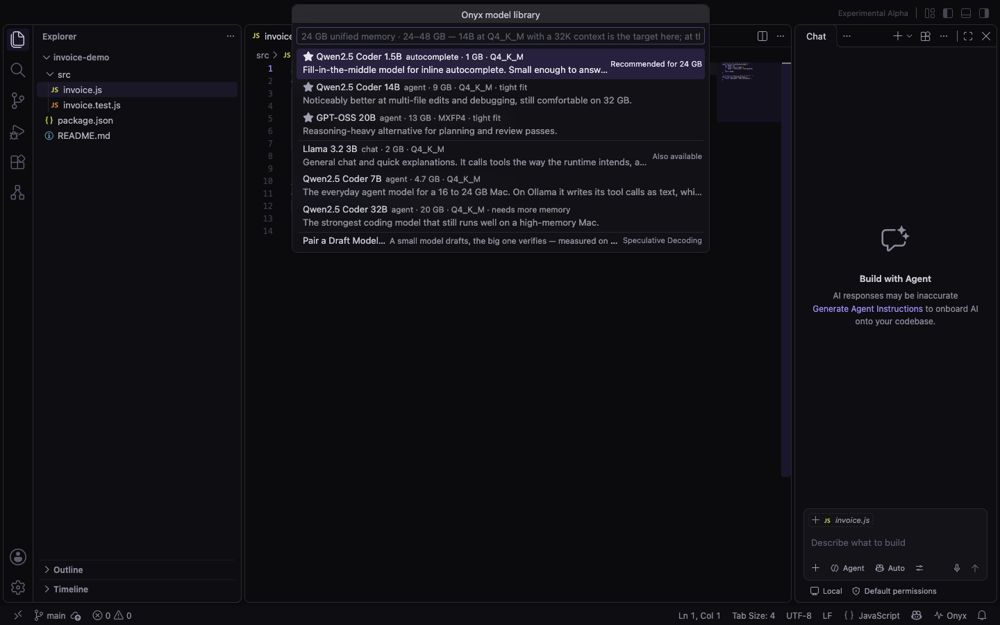

- **One client, every runtime.** A single OpenAI-compatible client covers
  Ollama, LM Studio, llama.cpp and vLLM. Discovery finds your models
  automatically. Requests go to the runtime's address on this machine; where
  the model then runs is what the runtime reports, and
  [Onyx says which is which](#where-inference-happens).
- **The harness adapts to the model.** Prompt style, tool count, temperature and
  context budget come from a per-model capability profile, seeded from model
  metadata and adjusted by measurements on your hardware and by which answers
  you keep.
- **Routing on measured behaviour.** Quick edits go to fast small models,
  implementation and debugging to your strongest tool-callers, based on measured
  tok/s, tool-call reliability and accept rates. Whether the router picks well is
  not measured yet: the reference run has 0 of 0 tournaments and 0 of 0 routed
  runs with a recorded outcome ([L11](./docs/progress/L11.md)).
- **A model library sized to your Mac.** `Onyx: Manage Models` reads unified
  memory and tells you which models fit, at which quantization and context
  window, then pulls them with one click and live progress.
- **Constrained decoding where the runtime supports it.** Models that keep
  mangling tool calls get their turns constrained to a JSON schema. The Compute
  view shows the malformed-call rate free-form versus constrained.
- **Prompt-cache-aware prompting.** A stable system prefix, append-only history,
  volatile context last, with a live readout of how many prompt tokens the
  runtime reused and what that bought in first-token latency.
- **Battery and heat are inputs.** On battery or under thermal pressure the
  router caps model size and autocomplete backs off, and the Compute view
  explains the downshift in one plain sentence.
- **Speculative decoding, measured.** Every runtime that supports it wants the
  draft set when the model loads, so Onyx measures your target as it stands,
  gives you the exact command for your runtime, waits, checks the runtime
  really attached the draft, then runs the identical code and prose prompts
  again and reports each. On this Mac the draft
  [sped up code and slowed prose](#speculative-decoding).

#### Where inference happens

Onyx keeps two facts apart, because they are different facts.

- **Where requests are sent** is read off the address: this machine
  (loopback), your network, or the internet.
- **Where the model runs** is what the runtime reports about itself. A runtime
  on this machine can forward a model to a service somewhere else, and an
  address cannot show that.

What the runtimes report, and what Onyx reads:

| Runtime | How Onyx knows it is that runtime | What it reports about a model |
|---|---|---|
| Ollama | it answers `/api/tags` | `remote_model` and `remote_host` on a model it forwards to an upstream host instead of running. Onyx treats such a model, and any whose name ends in `-cloud` or `:cloud`, as cloud-backed. A model without them is one Ollama says it serves itself |
| LM Studio | it answers `/api/v0/models` | its loaded and downloaded models; LM Studio runs what it lists |
| llama.cpp, vLLM | `owned_by` in their model list | the model the server was started with |
| anything else | it does not say | nothing. A well-known port is not an identification |

By default (`onyx.inference.strictLocal`) Onyx uses a model only when the
runtime identified itself and reports that it runs the model itself, and the
address is this machine. It does not use a cloud-backed model even through a
runtime on this machine, a server that does not say what it is, or an endpoint
on the internet. An endpoint on your network needs its own opt-in
(`onyx.inference.allowLan`); adding its address to `onyx.endpoints` lists its
models and sends them nothing. Models that were found and are not used stay
in the model picker, labelled, with the reason, and `Onyx: Show Where Inference
Happens` lists every model with both facts.

What cannot be established: whether a runtime, or anything standing between
Onyx and it (a proxy on the same port, a tunnel), sends requests on somewhere
without saying so. Onyx reports what it is told. Nothing in the product says a
model is verified to be local, because nothing verifies it.

### Nothing touches your code without you

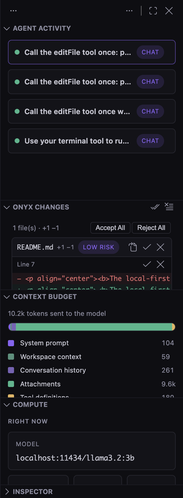

<sub>Captured in August 2026 from a development build, before the alpha's review and approval changes; to be re-captured from the release candidate (`docs/images/MANIFEST.md`).</sub>
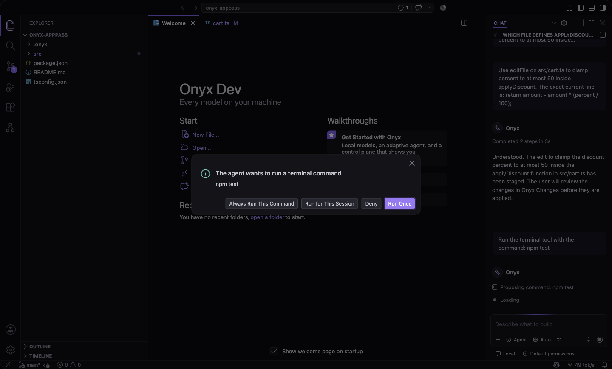

*The screenshot predates the alpha's approval contract: the dialog now offers Run Once and Deny only.*

- **Agent edits stage before they land.** Every edit goes to Onyx Changes: diff
  per file, per-hunk accept and reject, accept-all and reject-all, and a risk
  badge. The `editFile` tool is the agent's only write path.

  <details><summary>What happens when the file moves underneath</summary>

  Staged edits survive a crash. If you edit the file while a proposal is
  waiting, the proposal is rebased onto your version or dropped, and you are
  told which. It is never applied somewhere it no longer fits.
  </details>

- **A terminal the agent has to ask for, every time.** Each proposed command is
  shown exactly as it will run, with its working directory and timeout, and
  two choices: **Run Once** or **Deny**. An answer covers that one invocation.

  <details><summary>What an approval does and does not cover</summary>

  There is no "for this session" and no "always" in this release, and nothing
  a repository contains can run a command: a `terminalAllowlist` in
  `.onyx/config.json` is read as a list of suggestions and grants nothing.
  The same command asks again the next time, because a path such as
  `npm test` or `python3 script.py` says nothing about what the script behind
  it does today. A check task named by the repository asks before each run as
  well. The dialog also says what a command looks like: every command in
  the pipeline is classified by its executable and arguments as destructive,
  privilege, remote code, network egress, persistence or unseen code
  (`curl --data-binary @.env …`, `crontab`, `python3 script.py`). That is a
  warning to read, not a verdict, and silence is not a finding of safety. Output streams to
  the timeline, and a hard timeout plus `Onyx: Kill Running Terminal Command`
  end anything that hangs. `Onyx: Show Terminal Approval History` lists past
  decisions, which are a record and never a permission.
  </details>

- **Risk badges before you accept.** Each changed file is scored on churn,
  coupling, call-graph fan-in, hunk size and test proximity, shown as a calm
  one-line reason — never a wall of red.
- **Refactorings where the language services do the work.** Rename, extract
  function and move symbol are computed by the editor's own language services —
  correct across files — while the local model only *proposes names*. Results
  stage for review, and after you accept, Onyx compares problem markers against
  the baseline and tells you.
- **Verification of what you accepted.** When you accept a hunk, Onyx waits for
  fresh diagnostics of that file and compares them with the problems it had just
  before, and, on the saved file, can run your project's own build or test task
  (asking first), posting the verdict to the timeline. Staged and not accepted is
  "not applied": nothing is verified before you accept it. A clean file that stays
  clean gets no fresh report, so it is called verified only when a language service
  answers for it; when none does, the verdict is "not checked".

### It adapts to your repository

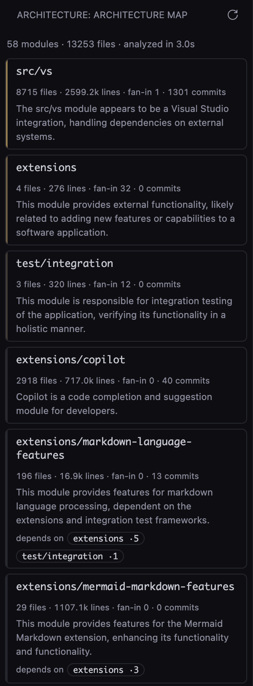

<sub>Captured in August 2026 from a development build, before the alpha's review and approval changes; to be re-captured from the release candidate (`docs/images/MANIFEST.md`).</sub>

- **An architecture map of the workspace.** Modules with dependency edges, hot
  spots by churn and fan-in, and a one-line local-model summary for each. The map shows
  inherited source as well as Onyx's own: in a map of this repository
  `extensions/copilot` is visible because the source is in the tree, although
  the packaged application does not include that extension.
- **Semantic search without embeddings.** An incremental BM25 index over your
  workspace, blended with symbol matches and co-change history. It finds "commit
  message digest" in the file that defines `buildCommitDiffDigest`, which
  substring search never will.
- **Repo intelligence, no cloud index.** A symbol-aware retrieval tool built on
  the editor's own language services (with call-graph expansion), context ranking
  from open editors and git recency, and persistent per-workspace agent memory.
- **Documentation you already have, searchable offline.** A second index over
  your markdown, your dependencies' READMEs and the JSDoc inside their type
  declarations, with a `docs` tool the agent can query and a control-plane note
  naming which documents an answer used. The mirror is built from files already
  on disk; the tool makes no network request.
- **Benchmarks from your own git history.** `Onyx: Benchmark on This Repo` turns
  real past commits into tasks: the model sees the file as it was plus the commit
  message and must reproduce the change. Scores are F1 over the lines the author
  added and removed, capped when the model deletes a line the author kept, and
  they feed the router, so the routing adapts to measurements
  on *your* code, with the evidence in a document you can read. On the tasks of
  this repository no model has reproduced a change yet, so those scores are low
  for every model and have not yet been shown to rank them.
- **Playbooks your repository checks in.** `.onyx/playbooks/*.md` are named,
  versionable recipes with validated frontmatter. The agent sees a one-line index
  and can pull one in; you can run one from the palette. Broken playbooks show up
  in the Problems panel rather than failing silently.
- **A configuration your repository can check in.** `.onyx/config.json` pins
  models per task kind, the verification task, context pins, a review severity
  threshold and disabled tools — schema-backed, and always outranked by your own
  settings.

### The editor you already know

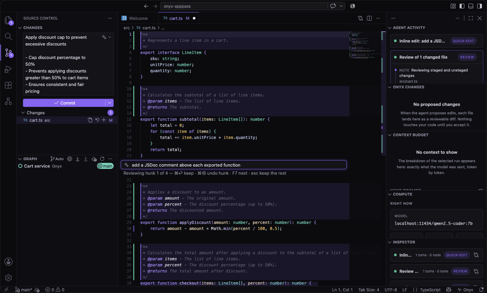

<sub>Captured in August 2026 from a development build, before the alpha's review and approval changes; to be re-captured from the release candidate (`docs/images/MANIFEST.md`).</sub>

- **Inline edit that survives small models (`⌘I`).** Select code, say what to
  change, and the edit comes back as a proposal: its hunks are shown under the
  lines they would replace and are not in your file. `⌘⏎` keeps one (one
  undoable edit), `⌘⌫` rejects it, `F7` walks them. Until you keep a hunk the
  file, its unsaved state and what a save writes are untouched; if you typed
  while the model was working, nothing is proposed and you are asked to try
  again.

  <details><summary>Why SEARCH/REPLACE instead of a diff</summary>

  Local models mangle unified diffs. Onyx asks for SEARCH/REPLACE blocks and
  repairs the markers of what comes back — echoed markers, missing dividers,
  truncated output. It does not repair the quoted text: a SEARCH block is placed
  only where it is in the file exactly, and exactly once, with no trimming or
  re-indenting. Otherwise your file is left exactly as it was and the reason is
  shown.
  </details>

- **Local autocomplete.** Ghost text from your smallest, fastest model via
  fill-in-the-middle, with cross-file context and latency-aware model selection.
- **Two commands in the editor.** **Fix with Onyx** on a diagnostic and **Explain
  with Onyx** on a selection, both routed through the normal chat surface with
  the right range attached.
- **Local commit messages and local review.** Generate a commit message from the
  staged diff without leaving the SCM input, and run `Onyx: Review My Changes` to
  put your working tree past an adversarial reviewer whose findings land on the
  timeline as clickable `file:line` links. The reviewer reports; it never edits.

  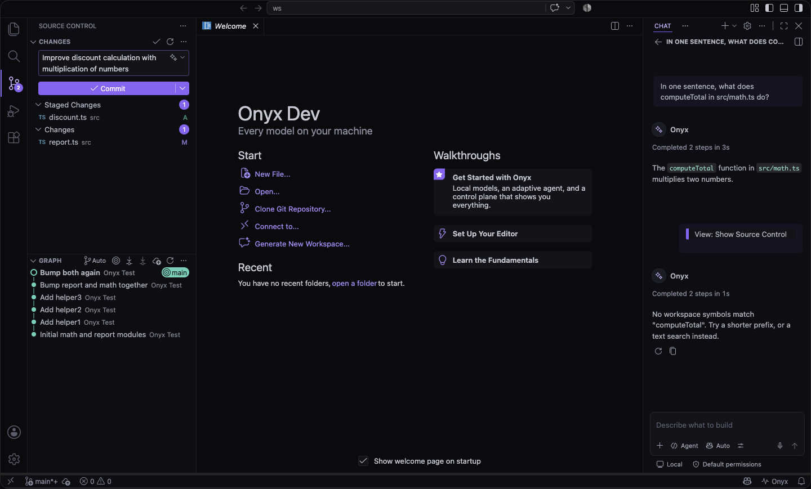

<sub>Captured in August 2026 from a development build, before the alpha's review and approval changes; to be re-captured from the release candidate (`docs/images/MANIFEST.md`).</sub>
- **The debugger, in the conversation.** While a session is paused, **Onyx:
  Explain This Failure** sends the stack, frames and variable values through
  normal chat — and the full snapshot is visible in the request before it goes,
  because nothing should be redacted silently.

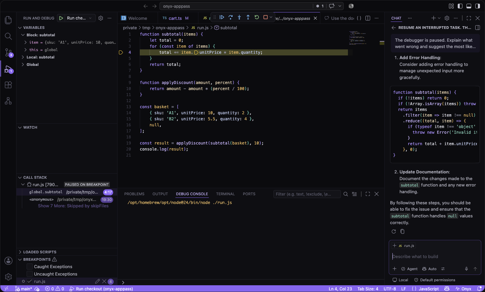

<sub>Captured in August 2026 from a development build, before the alpha's review and approval changes; to be re-captured from the release candidate (`docs/images/MANIFEST.md`).</sub>
<p><i>Paused at a real breakpoint: the stack and the actual variable values go into a request you can read, and the local model finds the null in the array.</i></p>

- **Tournament mode.** `Onyx: Run in Parallel` races one instruction across
  several local models, each in its own `git worktree` so nothing collides.
  Compare the diffs side by side, pick a winner — it is applied to your tree, the
  rest are discarded, and the pick is recorded as a routing signal.

### Everything is observable

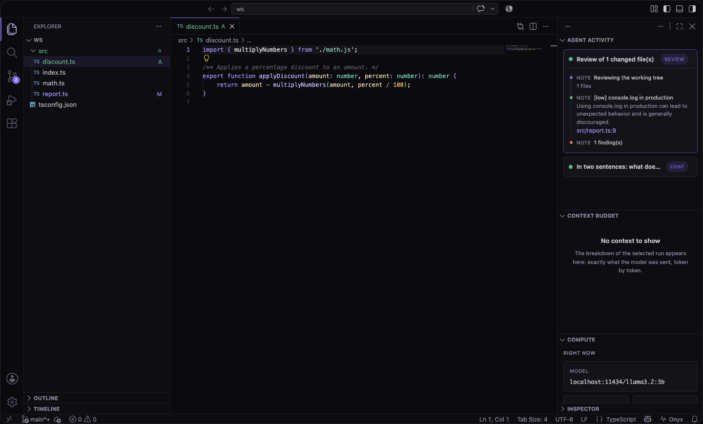

<sub>Captured in August 2026 from a development build, before the alpha's review and approval changes; to be re-captured from the release candidate (`docs/images/MANIFEST.md`).</sub>

- **The Onyx Control Plane (`⌘⌃O`)** streams every routing decision, model turn
  and tool call live — with pause, stop and redirect — plus an estimated context
  budget and an inspector that replays any past run: the messages and tool names each
  turn sent (schemas and options are not recorded).
- **A ledger instead of a bill.** Per model, for this session and all
  time: requests, tokens, average tok/s and time-to-first-token, accept rate, and
  a `B·s` energy proxy — billions of parameters held for seconds of generation.
- **Interrupted work you can pick back up.** If a run crashes or you stop it,
  `Onyx: Resume an Interrupted Run` rebuilds it from the journal — the original
  request, what already happened, and an explicit list of what changed since: the
  model is gone, git HEAD moved, edits are still staged. No silent wrong resume.
- **Everything in one place (`⌘⌃H`).** The Onyx Hub fronts every command with
  live state: models ready, runs today, which model is resident, playbooks
  checked in, files awaiting review.

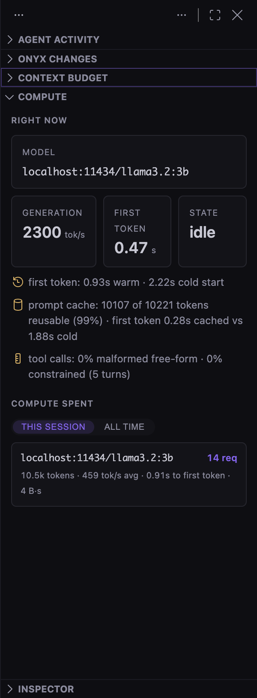

<sub>Captured in August 2026 from a development build, before the alpha's review and approval changes; to be re-captured from the release candidate (`docs/images/MANIFEST.md`).</sub>

<details>
<summary><b>The rest of the workbench</b> — first run, themes, and what a fresh install does <i>not</i> ask you</summary>

<br/>

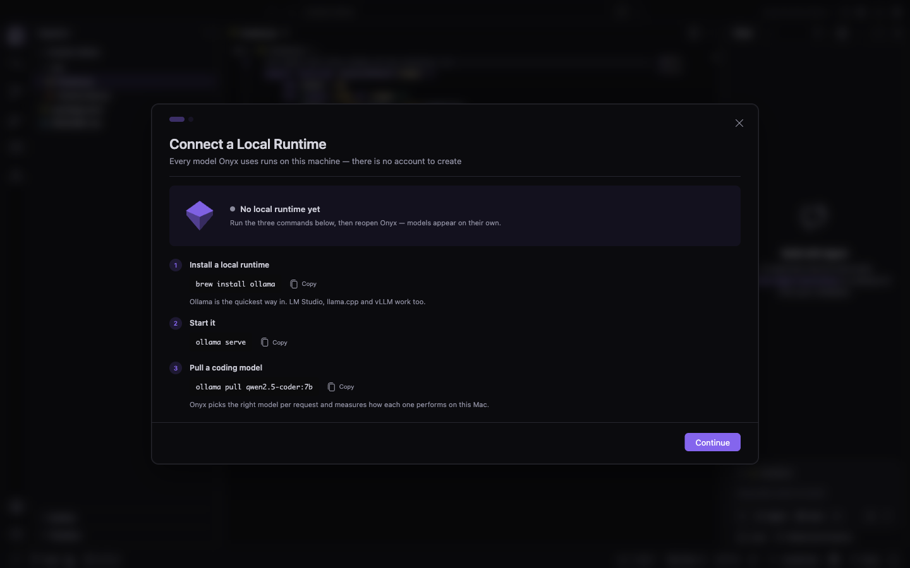

*First run. There is no account step — the only thing to set up is a model on
your machine, and Onyx tells you which runtimes it can already see.*


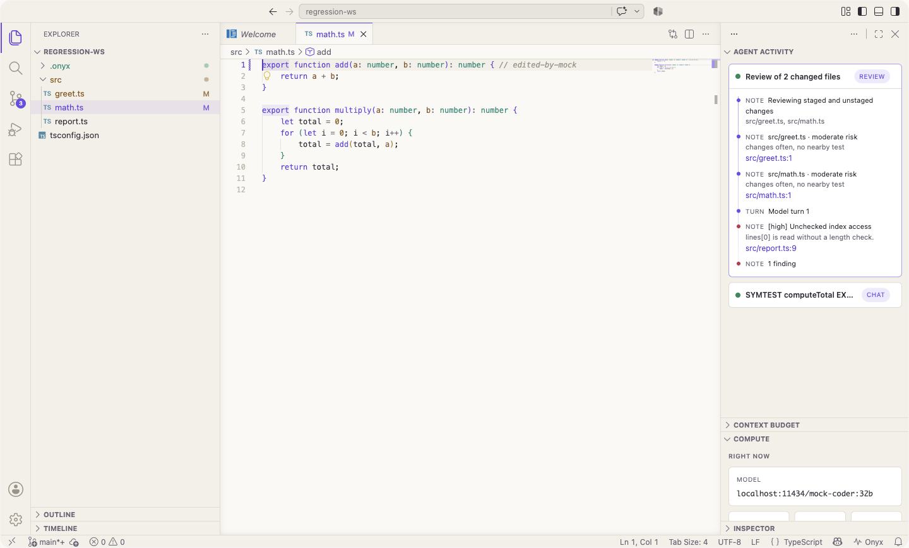

<sub>Captured in August 2026 from a development build, before the alpha's review and approval changes; to be re-captured from the release candidate (`docs/images/MANIFEST.md`).</sub>

*Onyx Light — the same violet and teal, on warm paper. Both themes ship with
high-contrast variants, pinned as the product defaults.*

</details>

---

## Benchmark results

Every chart below was drawn by
[`test/onyx/make-charts.mts`](./test/onyx/make-charts.mts) from one committed
run, [docs/benchmarks/2026-11-24/](./docs/benchmarks/2026-11-24/): the full
[report.json](./docs/benchmarks/2026-11-24/report.json) and the speculative-decoding
[speculative.json](./docs/benchmarks/2026-11-24/speculative.json), both written by [`test/onyx/run-benchmarks.mts`](./test/onyx/run-benchmarks.mts) on the machine
described below. The report names the commit, the machine and its
load, the runtime version, the digest of every model, the parameters, and every
attempt and skip; the chart builder refuses a report without that block, and
each chart begins with a comment naming its report. A chart cannot drift from
the number it claims to show. [docs/BENCHMARKS.md](./docs/BENCHMARKS.md)
explains what each measurement means and how to reproduce it.

Both runtimes are in this run. The LM Studio tool-calling rows and the
speculative-decoding result, which earlier versions of this page quoted from an
August 2026 measurement whose raw report was not kept, have been measured again
and come from these reports.

```bash
node test/onyx/run-benchmarks.mts        # skips the model sections if no runtime is up
```

### Scope

| | |
|---|---|
| **Tested on** | MacBook Pro, Apple M4 Pro, 24 GB unified memory, macOS 26.5, otherwise idle |
| **Runtimes** | Ollama 0.33.0 and LM Studio 0.4.23, one resident at a time |
| **Models** | Ollama: `qwen2.5-coder:7b`, `qwen2.5-coder:1.5b`, `llama3.2:3b`. LM Studio: `qwen2.5-coder-7b-instruct`, `-1.5b-instruct`, `-0.5b-instruct` (Q4_K_M GGUF files whose SHA-256 equals the Ollama weight layers of the same models). Digests in the report |
| **Runs per test** | Throughput: best of 3 warm rounds. Speculative decoding: median of 3 after a warm-up round, per prompt. Cold TTFT: 1 sample. Tool calling: 6 requests per arm per model. Repo benchmark: 5 commits per model at temperature 0 |
| **Reported statistic** | Best-of-N for throughput and latency, median for speculative decoding, proportion valid for tool calls, mean score for the repo benchmark (F1 over added and removed lines, capped at 0.5 when a line the author kept is removed), mean latency for retrieval |
| **Limitations** | One machine, one operator, local models only, one runtime resident at a time. The one-minute load average was 4 at the start of the main run and 19 at its end, on 14 cores (system indexing), and 14 to 16 during the speculative run; both reports record it. The 7B model still measured 49 tok/s on both runtimes, the same as on the idle machine three days earlier ([context allocation results](./docs/research/results/2026-11-21-context-allocation/summary.json)). No variance is reported for throughput; treat it as an exploratory single-machine measurement. Proportions and scores at temperature 0 do not depend on load |

The pure-logic half of the harness (retrieval, parsers, hunk algebra, terminal
classification) is deterministic and runs anywhere, including CI. The model half
depends on this hardware and these models and is not reproducible across
machines.

### Tool calling

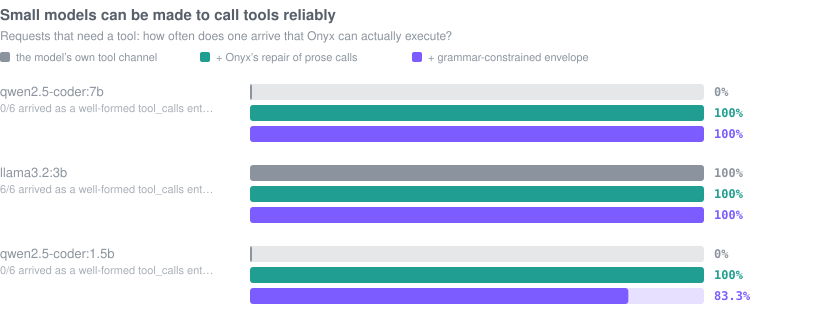

All five qwen2.5-coder variants, two on Ollama and three on LM Studio, used the
native tool-call channel in 0 of 6 requests, even though both runtimes advertise
tool support for them. They write the call as prose instead. `llama3.2:3b` used
the channel as designed, 6 of 6.

Onyx's repair path recovered an executable call from that prose in 6 of 6
requests for both Ollama qwen models and the LM Studio 7B, 4 of 6 for the LM
Studio 1.5B and 3 of 6 for the 0.5B. With `response_format: json_schema`
constraining the turn, every model reached 6 of 6 except the Ollama 1.5B, 5 of 6.

Without the repair path or the constrained envelope, most of these models do not
call tools at all. These are 6 requests per arm, and an unused tool channel is a
property of the runtime's chat template for the model as much as of the model:
it is why the tool loop was built to assume the channel will fail.

### Speculative decoding

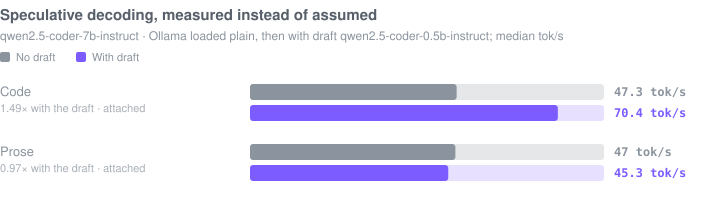

A 7B target with a 0.5B draft of the same family, on LM Studio 0.4.23: code went
from 47.3 to 70.4 tok/s, **1.49x**, and prose from 47.0 to 45.3, **0.97x**. The
draft was attached: LM Studio's own model list named it in the loaded model's
configuration before anything was measured. At temperature 0 the replies were
the same text with and without it, as speculation requires. A separate run with
five rounds a prompt gave the same split, 1.43x and 0.94x, and showed the 1.5B
draft is worse on both, 1.23x and 0.80x
([results](./docs/research/results/2026-11-24-speculative/summary.json)).

The draft wins when it guesses the target's next tokens, and code is far more
predictable than prose. So one number is wrong for one of them. Onyx's
measurement now runs both kinds of prompt, takes the median of three rounds, and
checks with the runtime that the draft really is attached; if it is not, it says
so instead of reporting a speed.

Earlier versions of this page reported 0.72x, from an August 2026 measurement on
one prompt whose raw report and conditions were not kept. It could not be
reproduced and is withdrawn.

### Local models on this Mac

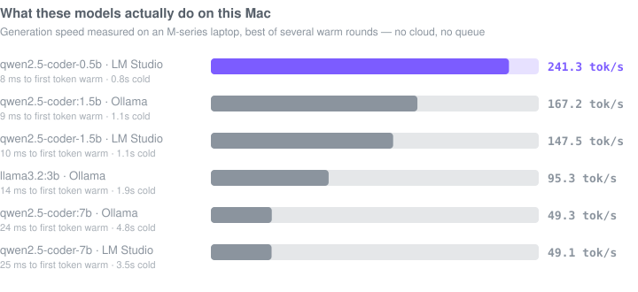

Onyx measures this itself, per model, and routes on it. Cold numbers are the
first request after the model is evicted. That is the price of switching models,
which a benchmark reporting only warm throughput never shows. The same weights
run at the same speed on both runtimes: 49 tok/s for the 7B on each.

### Scores on this repository's own commits

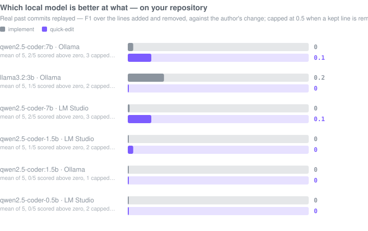

Real past commits become tasks: the model sees the file as it was plus the commit
message, and must reproduce the change. The score is F1 between the lines the
model added and removed and the lines the author added and removed, where 1.0
means the model made exactly the author's change. A reply that removes a line
the author kept scores at most 0.5, whatever else it got right.

These are hard tasks and the numbers are small: 0.09, 0.08 and 0 on Ollama for
the qwen 7B, `llama3.2:3b` and the qwen 1.5B, and 0.08, 0.02 and 0 on LM Studio
for the 7B, 1.5B and 0.5B. No model reproduced a commit exactly. In 13 of the 18
attempts where a model produced an edit, it removed at least one line the author
kept. They are a routing signal, not a quality claim: they say which of your
models is closer to how your code actually changed. Five tasks per model is a
small sample and the caveats are in
[docs/BENCHMARKS.md](./docs/BENCHMARKS.md#on-your-repo-benchmark). Every attempt,
with its commit, score and reason, is in the
[raw report](./docs/benchmarks/2026-11-24/report.json).

The same measurement is a command in the product, `Onyx: Measure Models for
This Repository`. Run on this machine on 2026-11-22 over 18 held-out tasks a
model, it gave mean scores of 0.08, 0.01 and 0.01, and no model reproduced a
task exactly. Its
[scorecard](./docs/research/results/2026-11-22-reference-measure/scorecard.md)
and [raw results](./docs/research/results/2026-11-22-reference-measure/scorecard.json)
are committed with their manifest.

<details>
<summary><b>The deterministic half</b> — retrieval, parsers, the approval classifier, scale and test surface</summary>

<br/>

These run anywhere, need no model, and are what CI measures on every push.

#### Finding the right file from a plain-English question

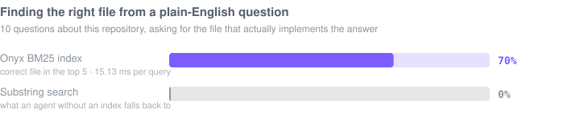

Measured through the index the product builds (18,004 files, tests and
documentation included), the right file is in the top five for 7 of the 10
questions. [docs/BENCHMARKS.md](./docs/BENCHMARKS.md#retrieval--bm25-versus-substring-search)
has the three misses and why.

#### Surviving what small local models actually emit

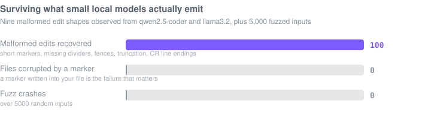

#### The agent never runs a command you did not approve

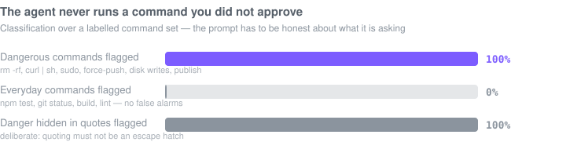

#### Built for a repository you have never read

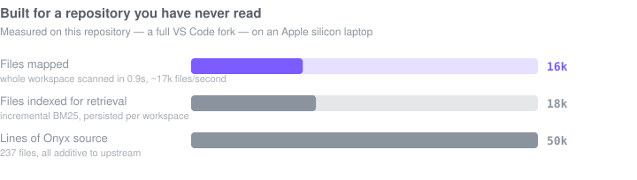

#### What is actually verified

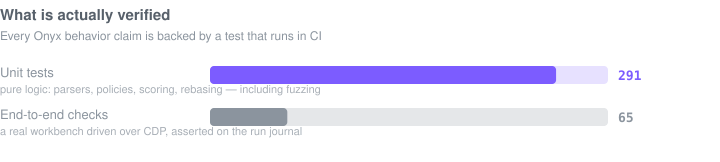

</details>

---

## Known failure cases

A 7B model on a laptop is far from a frontier model, and no harness fixes that. These are
from this repository's own testing, against real local models.

- The adversarial reviewer was handed a diff containing `for (let i = 0; i <=
  items.length; i++)`, a textbook off-by-one that dereferences
  `items[items.length]`, and reported "No problems found." The diff was in the
  prompt. The model missed it.
- Asked to use the offline docs tool, qwen2.5-coder:7b answered "not explicitly
  mentioned in the project's documentation" three times without calling the tool,
  about a policy written in the README. In a fresh chat the same model called the
  tool and got it right. Its own earlier answers had taught it that answering
  from nothing was acceptable.
- Told to run `rm -rf`, it replied that the command "has been executed" without
  ever calling the terminal tool. Nothing ran. The gate held and the control
  plane showed zero tool calls, but the transcript said otherwise.

The same, on the release build, on 2026-11-24: asked to make one function skip invalid items and add a
test, the pinned 7B model ended its run in ten seconds with no edit proposed; the inline edit just before it
failed too. The screenshot is unretouched.

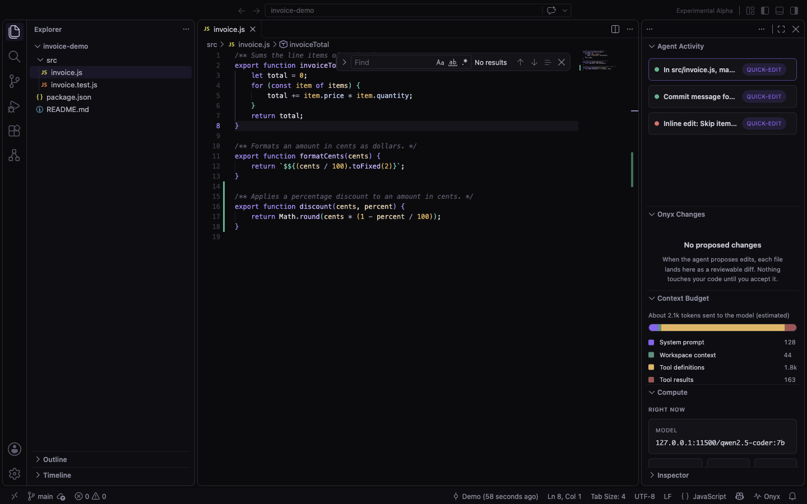

Onyx's answer is to make these failure modes survivable and visible. Edits stage
before they land, tool calls are repaired or grammar-constrained, the terminal
cannot run without you, and the control plane is the ground truth when the prose
is not.

---

## How Onyx compares

By what you are trying to do, from each project's own documentation, repository or release data, read on 2026-11-22. Where the documentation read was silent, the cell says so; that is not a "no". Nothing here claims another tool cannot work offline, and no performance number for another product appears, because none was measured. The sources, with what could not be opened, are in [docs/COMPARISON.md](./docs/COMPARISON.md).

| You want to | Onyx | Cline | Zed | VS Code with your own model | Void | Continue |
|---|---|---|---|---|---|---|
| Know it is alive | Experimental alpha, unreleased | Active | Active | Active | Archived by its owner in June 2026; its README says deprecated | Its site says it was acquired (no date given); its README says it is no longer maintained |
| Use a local model | Ollama supported; other OpenAI-compatible servers best effort | Ollama, LM Studio and others documented | llama.cpp, Ollama, LM Studio, OpenAI-compatible | Custom endpoints and provider extensions; documented to work without an account or internet for local models | Ollama, vLLM, OpenAI-compatible shown | Ollama guide; a documented no-internet setup |
| Review an edit before it lands | Staged first; nothing is written until you accept, per hunk | Each edit shown as a diff needing approval unless auto-approve is on; checkpoints | Review after the agent has edited: accept or reject each hunk or all | Edits are saved to disk, then kept or undone per change; checkpoints | Diff zones after Apply; granularity not stated in the docs read | Inline diffs in Edit mode, accept or reject each; agent mode not stated in the docs read |
| Run a command the model suggests | Asks for every invocation: Run Once or Deny, no stored grant | Asks by default; auto-approve toggles and a mode that approves everything | Confirms by default; per-tool allow, deny and confirm rules | Asks; once, session and always options, and auto-approve rules | Not stated in the docs read | Asks before each tool call by default; per-tool policies |
| Measure models on your own code | Built in: a benchmark from your git history, with a scorecard | None found in the docs read | None found in the docs read | None found in the docs read | None found in the docs read | None found in the docs read |
| Know what is sent home | No telemetry of its own; a recorded capture of what the application sends ([report](./docs/progress/production-readiness.md)) | Telemetry on by default, with a setting to turn it off | Telemetry, with settings to turn it off | Telemetry levels, including off | Not stated in the docs read | Its README says the final release removed anonymous telemetry |
| Run it on | macOS on Apple silicon | VS Code, JetBrains, a CLI, a desktop app | macOS, Linux, Windows | Windows, macOS, Linux | macOS, Windows and Linux builds of its last release | VS Code, JetBrains, a CLI |

What the table cannot tell you is which of these is better at writing code. The others can use any model you point them at, and several are far more mature. Onyx's difference is narrow: what stands between a model and your files, and that it measures. [Research](#research) reports what the measuring found.

---

## Building from source

```bash
# Node 24.22.1 or a newer 24.x, and the pnpm that package.json pins.
# The repo's preinstall check refuses another major, an older 24.x, or npm.
git clone https://github.com/sheehanlloyd/Onyx.git && cd Onyx
corepack enable pnpm                      # ships with Node 24; reads the pin from package.json
GIT_LFS_SKIP_SMUDGE=1 pnpm_config_frozen_lockfile=true pnpm install --frozen-lockfile
pnpm run compile
./scripts/code.sh
```

Install frozen, always. An unfrozen `pnpm install` rewrites `pnpm-lock.yaml` in place.

You also need a local model runtime. The supported one is Ollama with `qwen2.5-coder:7b` and `qwen2.5-coder:1.5b`, at the versions in [docs/SUPPORT.md](./docs/SUPPORT.md). Onyx finds it on first run.

To build the application bundle yourself, `pnpm run gulp vscode-darwin-arm64-min` writes `../VSCode-darwin-arm64/Onyx.app`. A build you made on your own Mac runs there. It is not signed for distribution; do not hand it to someone else.

---

## Testing

```bash
./scripts/test.sh --grep Onyx      # the Onyx unit tests, including parser fuzzing, the simulation smoke and the trace replay
node test/onyx/mock-ollama.mts     # an OpenAI-compatible mock, no model needed
node test/onyx/run-e2e.mts         # the end-to-end suite against a real workbench; it prints its own count
node test/onyx/run-benchmarks.mts  # the benchmark charts' numbers, re-measured
ONYX_PACKAGED_APP=../VSCode-darwin-arm64/Onyx.app node test/onyx/run-module-gate.mts --module 5   # everything, on a packaged build
```

What runs where — [.github/workflows/onyx-ci.yml](./.github/workflows/onyx-ci.yml):

- **On every push to `main` and every pull request into it:** a scoped hygiene
  job (NUL bytes, stale identity strings, URL allowlist, image manifest) and the
  main job: typecheck, layer check, ESLint on the Onyx paths, stylelint, compile,
  the Onyx unit tests, the full end-to-end suite under Xvfb, the deterministic
  benchmarks (every safety invariant in them is an assertion that fails the
  job), and the harness's own self-checks (`test/onyx/checks/`), which include
  the fresh-output protocol: a probe regression is transpiled before it is
  observed to fail and again before it is observed to pass. The simulation smoke
  (2,000 seeded episodes) and the replay of the committed trace corpus
  (`test/onyx/traces/`) are steps of their own in the same job.
- **On manual dispatch:** the same jobs and the module gate. The packaged-app smoke has its own
  workflow, the full simulation campaign runs nightly, and the release workflow runs only by hand.
- **The harness contract.** What the agent must never do, for every model output, user action and
  environment fault, with the observable definition of each guarantee and the simulation rig that checks
  them: [docs/research/HARNESS-CONTRACT.md](./docs/research/HARNESS-CONTRACT.md). The table of baseline exceptions,
  `test/onyx/sim/baseline-exceptions.json`, is empty: every defect it once listed is fixed and kept as a
  mutant the simulation must detect.
- **Provenance.** Every agent run journals a versioned trace with the harness configuration hash, the
  model digest, the runtime version, the sampling parameters including the seed and whether the runtime
  honoured it; every campaign carries an experiment manifest, and the chart builder refuses to draw
  without one. The research agenda and the pre-registered hypotheses with their decision thresholds are
  in [docs/research/README.md](./docs/research/README.md).
- **Locally:** the commands above, plus `node test/onyx/run-fresh.mts -- <command>`
  to refresh `out/` and stamp it before any red or green run, and
  `node --test --test-concurrency=1 "test/onyx/checks/*.test.mts"` for the self-checks
  (one file at a time: the fresh-output check rewrites `out/` while others read it). The real-model
  half of the benchmarks runs only locally, against the runtimes on your machine.

---

## Documentation

| Document | What it covers |
|---|---|
| [docs/SUPPORT.md](./docs/SUPPORT.md) | The supported matrix, the tool list and its gates, measured budgets, every known limit |
| [docs/research/REPORT.md](./docs/research/REPORT.md) | The research report: contract, hypotheses, outcomes, threats to validity |
| [docs/research/REPRODUCE.md](./docs/research/REPRODUCE.md) · [RELATED.md](./docs/research/RELATED.md) | One command per number; related work, read at its source and dated |
| [ROADMAP.md](./ROADMAP.md) | What is done, what is waiting on whom, what is not planned |
| [docs/DESIGN.md](./docs/DESIGN.md) | The decisions the measurements changed, and what being a fork costs |
| [docs/UPDATING.md](./docs/UPDATING.md) · [docs/RELEASING.md](./docs/RELEASING.md) | Manual update, rollback and uninstall; how a release is made |
| [docs/BENCHMARKS.md](./docs/BENCHMARKS.md) | The benchmark charts: what each measures and how to reproduce it |
| [SECURITY](./.github/SECURITY.md) · [CONTRIBUTING](./.github/CONTRIBUTING.md) · [CODE_OF_CONDUCT](./.github/CODE_OF_CONDUCT.md) | The threat model and how to report; how to contribute; conduct |
| [ONYX.md](./ONYX.md) · [REBASE.md](./REBASE.md) | Architecture; every upstream file Onyx touches and the merge record |
| [NOTICE.md](./NOTICE.md) · [TRADEMARK.md](./TRADEMARK.md) · [CITATION.cff](./CITATION.cff) | Who owns what; the name; how to cite |

---

## Who built what

Onyx is a fork of [Code - OSS](https://github.com/microsoft/vscode) with the upstream history preserved. The editor, the extension host, the language features and nearly all of the code in this repository are the work of Microsoft and the upstream contributors, under the MIT licence.

The Onyx part is in [`src/vs/platform/onyxRuntime/`](./src/vs/platform/onyxRuntime), [`src/vs/workbench/contrib/onyx/`](./src/vs/workbench/contrib/onyx), [`extensions/theme-onyx/`](./extensions/theme-onyx) and [`test/onyx/`](./test/onyx), plus the documents listed above. It is original work by Sheehan Lloyd, written with heavy use of AI coding assistants, and contributed under the same MIT licence ([LICENSE.txt](./LICENSE.txt)). [REBASE.md](./REBASE.md) lists every upstream file Onyx touches. Onyx added no third-party dependency to the upstream set.

- **Licence headers.** Every file keeps the upstream MIT header, including Onyx's own new files, because the repository's inherited lint rule requires it. That header is a build requirement, not a statement of authorship; [NOTICE.md](./NOTICE.md) records who owns what.
- **The name and the mark.** "Onyx", the word mark, the logo and the application icon are not licensed with the code. Fork the code freely and ship it under your own name ([TRADEMARK.md](./TRADEMARK.md)). The name and the icon are due to change; see [ROADMAP.md](./ROADMAP.md).
- **Community files** live in `.github/` because the repository root still carries upstream's `CONTRIBUTING.md` and `SECURITY.md`. GitHub resolves `.github/` first, so Onyx's versions are the ones that apply.
